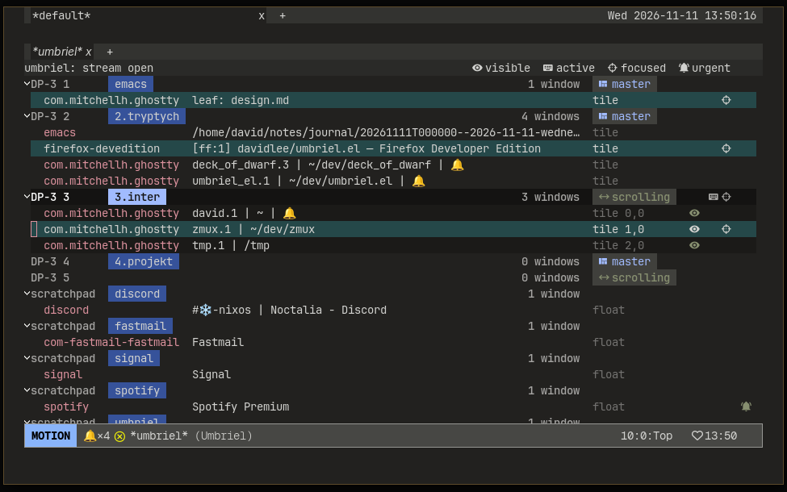

# umbriel.el

An Emacs client for [umbriel](https://github.com/davidlee/umbriel), a Wayland
compositor. It talks to the compositor's JSON socket (no binary is executed)
and shows workspaces, scratchpads and windows in a `*umbriel*` buffer built on
`magit-section`, with row actions, plus a hook that focuses the frame an
`emacsclient` reuses.

## Requirements

- Emacs 30.1 or later
- `magit-section` 4.0 or later
- a running umbriel compositor (the socket path comes from the environment)



## Install

There is no package archive yet. With `use-package` (Emacs 30's `:vc`):

```elisp
(use-package umbriel
  :vc (:url "https://github.com/davidlee/umbriel.el")
  :config (umbriel-focus-mode 1))   ; focus the frame emacsclient reuses
```

Or from a checkout:

```elisp
(add-to-list 'load-path "~/dev/umbriel.el")
(require 'umbriel)          ; M-x umbriel opens *umbriel*
(umbriel-focus-mode 1)
```

## Keys

The `*umbriel*` buffer has its own keys in `umbriel-buffer-mode-map` (`?`
lists them). Change them with `keymap-set`:

```elisp
(with-eval-after-load 'umbriel-buffer
  (keymap-set umbriel-buffer-mode-map "f" #'umbriel-focus))
```

The package binds no global keys. `umbriel-command-map` holds the commands
that work anywhere; bind it to a prefix of your choice:

```elisp
(keymap-global-set "C-c u" umbriel-command-map)  ; C-c u u, C-c u w, C-c u l
```

See [docs/umbriel.md](docs/umbriel.md) for the commands, options, faces, row
actions and the design notes.

## Development

```sh
nix develop        # Emacs with magit-section and package-lint, just, ripgrep
just check         # lint (parens, byte-compile with warnings as errors,
                   # package-lint, checkdoc) + tests
```

Layout: the library at the root, `test/` the ERT suites,
`dev/umbriel-test-runner.el` the batch runner, `bin/` the paren checker.
CI (`.github/workflows/check.yml`) runs `just check` on Emacs 30.1 and master.

Changes: [CHANGELOG.md](CHANGELOG.md).

## License

GPL-3.0-or-later. See [LICENSE](LICENSE).
